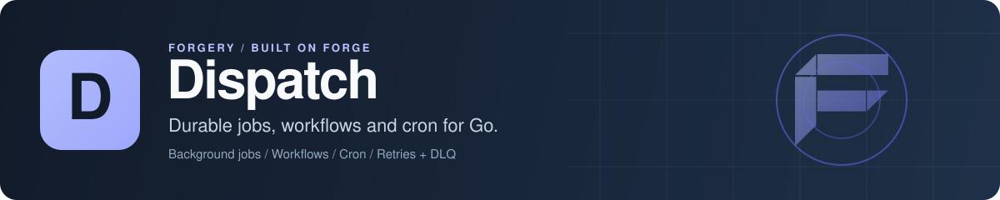

<p align="center">
  
</p>

# Dispatch: durable background jobs, workflows and cron for Go

Dispatch is an open-source durable execution library for Go. You import it, hand it a store, and register background jobs, multi-step workflows and cron schedules as plain Go functions. Retries with backoff, a dead letter queue, distributed workers with leader-elected cron, checkpointed workflows that resume after a crash, and a history-based durable workflow runtime with signals, queries and child workflows all run inside your own process, against PostgreSQL, SQLite, MongoDB, Redis or memory. There's no separate server to deploy. It runs standalone or as a [Forge](https://github.com/xraph/forge) extension with a REST admin API.

[](https://go.dev/dl/) [](https://github.com/xraph/dispatch/actions/workflows/ci.yml) [](https://pkg.go.dev/github.com/xraph/dispatch) [](https://github.com/xraph/dispatch/stargazers)

[Documentation](https://www.xraph.com/docs/dispatch) · [Quick start](#quick-start) · [Features](#why-dispatch) · [Jobs](#background-jobs) · [Workflows](#workflows) · [Cron](#cron) · [Stores](#stores) · [Forge](#use-it-with-forge) · [Examples](#examples) · [FAQ](#faq)

## Quick start

You need [Go 1.26 or later](https://go.dev/dl/). This uses the in-memory store, so there's nothing else to install:

```bash
mkdir hello-dispatch
cd hello-dispatch
go mod init example.com/hello-dispatch
go get github.com/xraph/dispatch@latest
```

Save this as `main.go`:

```go
package main

import (
	"context"
	"fmt"
	"log"
	"time"

	"github.com/xraph/dispatch"
	"github.com/xraph/dispatch/engine"
	"github.com/xraph/dispatch/job"
	"github.com/xraph/dispatch/store/memory"
	"github.com/xraph/dispatch/workflow"
)

type Signup struct {
	Email string `json:"email"`
}

var done = make(chan struct{})

var SendWelcome = job.NewDefinition("send_welcome",
	func(ctx context.Context, in Signup) error {
		fmt.Println("job: welcome email to", in.Email)
		return nil
	},
	job.WithMaxRetries(5),
)

var Onboard = workflow.NewWorkflow("onboard",
	func(wf *workflow.Workflow, in Signup) error {
		if err := wf.Step("create-account", func(ctx context.Context) error {
			fmt.Println("workflow: account created for", in.Email)
			return nil
		}); err != nil {
			return err
		}

		return wf.Step("notify", func(ctx context.Context) error {
			fmt.Println("workflow: team notified")
			close(done)
			return nil
		})
	},
)

func main() {
	ctx := context.Background()

	d, err := dispatch.New(
		dispatch.WithStore(memory.New()),
		dispatch.WithConcurrency(4),
	)
	if err != nil {
		log.Fatal(err)
	}

	eng, err := engine.Build(d)
	if err != nil {
		log.Fatal(err)
	}
	engine.Register(eng, SendWelcome)
	engine.RegisterWorkflow(eng, Onboard)

	if err := d.Start(ctx); err != nil {
		log.Fatal(err)
	}
	defer d.Stop(ctx)

	in := Signup{Email: "ada@example.com"}
	if _, err := engine.Enqueue(ctx, eng, "send_welcome", in); err != nil {
		log.Fatal(err)
	}
	if _, err := engine.StartWorkflow(ctx, eng, "onboard", in); err != nil {
		log.Fatal(err)
	}

	select {
	case <-done:
		time.Sleep(200 * time.Millisecond) // give the job worker a moment
	case <-time.After(10 * time.Second):
		log.Fatal("timed out")
	}
}
```

Run it:

```bash
go run .
# workflow: account created for ada@example.com
# workflow: team notified
# job: welcome email to ada@example.com
```

The workflow prints first because `StartWorkflow` runs it in the calling goroutine, checkpointing each step as it goes, while the job waits in the queue for one of the four workers to poll it. Payloads are JSON, so whatever you pass to `Enqueue` has to marshal cleanly.

The memory store is for development and tests. Swap in `postgres.New(groveDB)` from `store/postgres` (see [Stores](#stores)) and the same jobs, workflow checkpoints and cron entries survive a restart and spread across every process that runs the engine.

## Why Dispatch?

Most job queues give you jobs, and you build workflows, schedules and failure handling on top. Dispatch gives you all of it as a library inside your Go service, so a job handler is a typed function you can unit test and the queue is a table in the database you already run.

| You need | Dispatch gives you |
| --- | --- |
| Background jobs | Typed `job.Definition[T]` handlers with queues, priority, delayed `RunAt`, timeouts and retries |
| Sane retries | Constant, linear, exponential and jittered backoff (exponential with jitter, 1s to 1m, by default) |
| A place for jobs that keep failing | A dead letter queue you can list, replay one by one or in bulk, and purge. Wrap an error in `dispatch.ErrPermanent` to skip the remaining retries |
| Multi-step processes | Checkpointed workflows with `Step`, `Parallel`, `Sleep`, `WaitForEvent` and compensating steps for sagas, resumed from checkpoints after a restart |
| Long-running, signal-driven workflows | A history-based durable runtime with activities, timers, signals, queries, child workflows, continue-as-new and workflow retries |
| Cron that runs once per cluster | Leader-elected cron from cron expressions or `@every`, stored so every worker agrees |
| More than one worker | Worker registration, heartbeats and reassignment of jobs from workers that stop heartbeating, plus a Kubernetes Lease-based cluster store in `cluster/k8s` |
| Big jobs next to small ones | Resource-aware admission: jobs declare CPU, memory, disk or custom resources and workers only take what fits |
| Large inputs and outputs | An artifact plane that tracks objects in [Trove](https://github.com/xraph/trove) and stages them to a local cache |
| Visibility | Logging, recovery, timeout, OpenTelemetry tracing and metrics middleware, plus lifecycle hooks for audit logs and [Relay](https://github.com/xraph/relay) webhooks |
| An admin surface | REST routes for jobs, workflow runs, the DLQ and crons, the Dispatch Wire Protocol over WebSocket, and Go, TypeScript and Python clients |

The [architecture guide](https://www.xraph.com/docs/dispatch/architecture) shows how the dispatcher, the engine, the worker pool and the stores fit together.

## Background jobs

A job definition is a name, a typed handler and options. Register it with the engine, then enqueue it by name:

```go
var ResizeImage = job.NewDefinition("resize_image",
	func(ctx context.Context, in ResizeInput) error {
		if in.Width <= 0 {
			return fmt.Errorf("bad width %d: %w", in.Width, dispatch.ErrPermanent)
		}
		return resize(ctx, in)
	},
	job.WithQueue("media"),
	job.WithMaxRetries(5),
	job.WithTimeout(2*time.Minute),
)

engine.Register(eng, ResizeImage)

_, err := engine.Enqueue(ctx, eng, "resize_image", ResizeInput{Width: 640},
	job.WithPriority(10),
	job.WithRunAt(time.Now().Add(time.Hour)),
)
```

Unless you say otherwise, your job gets 3 retries, the `default` queue and a 5 minute timeout. When it runs out of retries, or returns an error wrapping `dispatch.ErrPermanent`, it moves to the dead letter queue. Workers only poll the queues you give `dispatch.WithQueues`, and `engine.WithQueueConfig` adds per-queue rate limits and concurrency.

## Workflows

Dispatch has two workflow models. You can run both in one engine, and which one you pick mostly comes down to how long your process lives and whether something outside it has to talk to it while it runs.

Checkpointed workflows (`workflow` package) are ordinary Go functions made of named steps. Each completed step is recorded, so if your process dies partway through, the next engine start resumes the run and skips the steps that already finished. You also get `Parallel`, `Sleep`, `WaitForEvent`, `WaitForAll`, `WaitForAny`, `StepWithCompensation` for sagas, child workflows and versioned definitions with `NewWorkflowV`. Failed runs can be replayed from a chosen step.

Durable workflows (`durable` and `durable/runtime`) replay a deterministic handler against recorded history, in the style of Temporal. You schedule activities, timers and signal receives as futures, and the runtime gives you signals, queries, selectors, async activity completion, child workflows, cancellation, execution timeouts, continue-as-new and whole-workflow retry policies. Turn it on with `engine.WithDurableWorkflows(...)`. It needs a store that implements `durable.Store`, which today means `store/memory` or `store/postgres`. Workflow code has to stay deterministic, so keep network calls, clocks and randomness in activities. The [`examples/`](examples/) directory has a runnable program for each feature.

## Cron

```go
err := engine.RegisterCron(ctx, eng, &cron.Definition[Report]{
	Name:     "nightly-report",
	Schedule: "0 2 * * *",
	JobName:  "build_report",
	Payload:  Report{Kind: "daily"},
})
```

Each tick enqueues an ordinary job, so your cron runs get the same retries, DLQ and middleware as everything else. One worker holds cron leadership at a time. Registering the same name again changes nothing, so you can call this on every start without worrying about duplicate schedules piling up in the store.

## Stores

`store.Store` combines the job, workflow, cron, DLQ, event, cluster and artifact stores, and every backend implements all of them.

| Package | Backend | Built from | Durable runtime |
| --- | --- | --- | --- |
| `store/memory` | In memory, for development and tests | `memory.New()` | yes |
| `store/postgres` | PostgreSQL | `postgres.New(*grove.DB)` | yes |
| `store/sqlite` | SQLite, for a single node | `sqlite.New(*grove.DB)` | no |
| `store/mongo` | MongoDB | `mongo.New(*grove.DB)` | no |
| `store/redis` | Redis | `redis.New(*kv.Store)` | no |

You hand the SQL and MongoDB stores a [Grove](https://github.com/xraph/grove) database, and the Redis store a Grove KV store. The persistent stores have a `Migrate` method that creates their tables or collections. `store/storetest` holds the conformance suites if you want to write your own. See the [store docs](https://www.xraph.com/docs/dispatch/stores/postgres) for each backend.

## Use it with Forge

The `github.com/xraph/dispatch/extension` package plugs Dispatch into a [Forge](https://github.com/xraph/forge) app. It depends on the Grove extension, picks up the `*grove.DB` it provides (Postgres, SQLite or MongoDB), runs the store migrations on start, builds the engine and provides `*engine.Engine` through DI. It also mounts the REST admin API under `/dispatch`.

```go
import (
	"github.com/xraph/dispatch/cron"
	"github.com/xraph/dispatch/engine"
	dispatchext "github.com/xraph/dispatch/extension"
	"github.com/xraph/forge"
	_ "github.com/xraph/grove/drivers/pgdriver"
	groveext "github.com/xraph/grove/extension"
)

jobs := dispatchext.New(dispatchext.WithConcurrency(8))

app := forge.NewApp(forge.AppConfig{
	Name:        "accounts",
	HTTPAddress: ":8080",
	Extensions: []forge.Extension{
		groveext.New(groveext.WithDSN("postgres", "postgres://localhost:5432/accounts?sslmode=disable")),
		jobs,
	},
})

err := app.RegisterHook(forge.PhaseAfterRegister, func(ctx context.Context, _ forge.App) error {
	eng := jobs.Engine()
	engine.Register(eng, SendWelcome)

	return engine.RegisterCron(ctx, eng, &cron.Definition[Signup]{
		Name:     "nightly-digest",
		Schedule: "0 2 * * *",
		JobName:  "send_welcome",
		Payload:  Signup{Email: "team@example.com"},
	})
}, forge.LifecycleHookOptions{Name: "register-jobs"})

err = app.Router().POST("/signup", func(ctx forge.Context) error {
	eng, err := forge.Inject[*engine.Engine](app.Container())
	if err != nil {
		return err
	}

	j, err := engine.Enqueue(ctx.Context(), eng, "send_welcome", Signup{Email: "ada@example.com"})
	if err != nil {
		return err
	}

	return ctx.JSON(http.StatusAccepted, map[string]string{"job_id": j.ID.String()})
})
```

`jobs.Engine()` is nil until the extension has registered, which is why the job registration sits in a `PhaseAfterRegister` hook. The admin routes (`/dispatch/jobs`, `/dispatch/workflows/runs`, `/dispatch/dlq`, `/dispatch/crons`, `/dispatch/stats` and their actions) authenticate through the Forge auth extension and authorize with [Warden](https://github.com/xraph/warden) by default. Pass `WithRemoteSecurity` to bring your own authenticator, or `WithDisableRoutes()` to mount nothing.

### Configuration

The extension reads `extensions.dispatch`, then falls back to a top-level `dispatch` key.

```yaml
extensions:
  dispatch:
    base_path: /dispatch
    grove_database: primary
    resources:
      enabled: true
      cpu_overcommit: 1.0
      memory_fraction: 0.8
```

| Key | Option | What it does |
| --- | --- | --- |
| `base_path` | `WithBasePath(path)` | Prefix for the REST routes, `/dispatch` by default |
| `disable_routes` | `WithDisableRoutes()` | Mounts no HTTP routes |
| `disable_migrate` | `WithDisableMigrate()` | Skips the store migrations on start |
| `grove_database` | `WithGroveDatabase(name)` | Uses a named `*grove.DB` from the container |
| `grove_kv`, `key_prefix` | `WithGroveKV(name)`, `WithKVKeyPrefix(p)` | Uses a Grove KV store with the Redis backend |
| `enable_dwp`, `dwp_base_path` | `WithDWP(...)` | Turns on the Dispatch Wire Protocol over WebSocket |
| `resources.enabled`, `cpu_overcommit`, `memory_fraction`, `explicit`, `custom_keys` | `WithResources()`, `WithCPUOvercommit`, `WithMemoryFraction`, `WithExplicitCapacity` | Resource-aware admission against detected worker capacity |
| `artifacts.enabled`, `trove_store`, `bucket`, `retention`, `cache.dir`, `cache.budget` | `WithArtifacts(store)`, `WithArtifactCacheDir`, `WithArtifactCacheBudget` | The artifact plane over a Trove store |
| `durable.enabled`, `namespace`, `queue`, `build_id`, `concurrency` | | The history-based durable runtime |
| `security.installation_id`, `policy_tenant`, `providers` | `WithOperatorSecurity(cfg)` | Which auth providers and Warden resource the admin routes use |

Worker tuning is code-only: `WithConcurrency`, `WithQueues`, `WithPollInterval`, `WithHeartbeatInterval`, `WithStaleJobThreshold` and the `WithCron*` options. A `dispatch:` block nested under the extension key parses, but nothing reads it, so set those from Go. `WithMiddleware`, `WithBackoff` and `WithExtension` add job middleware, a retry strategy and lifecycle hooks. The [Forge extension guide](https://www.xraph.com/docs/dispatch/guides/forge-extension) has more.

## Examples

Every directory under [`examples/`](examples/) is a runnable program for one feature of the durable runtime, built with the rest of the module:

| Example | What it shows |
| --- | --- |
| [durable-signals](examples/durable-signals/) | Start a workflow with a signal and wait for it |
| [durable-queries](examples/durable-queries/) | Read workflow state without changing it |
| [durable-children](examples/durable-children/) | Child workflows |
| [durable-selectors](examples/durable-selectors/) | Wait on whichever future finishes first |
| [durable-async](examples/durable-async/) | Activities completed from outside the worker |
| [durable-timeouts](examples/durable-timeouts/) | Activity and execution timeouts |
| [durable-cancellation](examples/durable-cancellation/), [durable-workflow-cancellation](examples/durable-workflow-cancellation/) | Cancelling activities and whole workflows |
| [durable-continuation](examples/durable-continuation/) | Continue-as-new |
| [durable-workflow-retry](examples/durable-workflow-retry/) | Whole-workflow retry policies |

Run one with `GOWORK=off go run ./examples/durable-signals`. A larger resource-aware example lives in [`_examples/resources`](_examples/resources/), which the Go tool skips in `./...`.

## Documentation

| Topic | Docs |
| --- | --- |
| Install and run a first job | [Getting started](https://www.xraph.com/docs/dispatch/getting-started), [full example](https://www.xraph.com/docs/dispatch/guides/full-example) |
| Pick a store | [PostgreSQL](https://www.xraph.com/docs/dispatch/stores/postgres), [SQLite](https://www.xraph.com/docs/dispatch/stores/sqlite), [MongoDB](https://www.xraph.com/docs/dispatch/stores/mongo), [Redis](https://www.xraph.com/docs/dispatch/stores/redis), [memory](https://www.xraph.com/docs/dispatch/stores/memory) |
| Handle failures | [Dead letter queue](https://www.xraph.com/docs/dispatch/subsystems/dlq), [errors](https://www.xraph.com/docs/dispatch/concepts/errors) |
| Watch it run | [Observability](https://www.xraph.com/docs/dispatch/subsystems/observability), [admin API](https://www.xraph.com/docs/dispatch/subsystems/admin-api), [DWP](https://www.xraph.com/docs/dispatch/subsystems/dwp) |
| Test your jobs | [Testing guide](https://www.xraph.com/docs/dispatch/guides/testing) |
| Call it from other languages | [Go](https://www.xraph.com/docs/dispatch/sdks/go), [TypeScript](https://www.xraph.com/docs/dispatch/sdks/typescript), [Python](https://www.xraph.com/docs/dispatch/sdks/python) clients |

The exported Go API is on [pkg.go.dev](https://pkg.go.dev/github.com/xraph/dispatch). The docs source is in [`docs/`](docs/), with design notes in [`docs/architecture/`](docs/architecture/).

## FAQ

### How do I run background jobs in Go without Redis or a separate server?

Use Dispatch with the PostgreSQL or SQLite store. Your queue lives in the database you already back up, the workers run inside your own process, and there's nothing new to deploy. Run more copies of your service and they share the work.

### Does Dispatch retry failed jobs?

Yes. Each job retries up to its `MaxRetries` (3 by default) with exponential backoff and jitter, then lands in the dead letter queue, where you can replay it. Return an error that wraps `dispatch.ErrPermanent` when a retry can't help.

### How is Dispatch different from Temporal?

Temporal is a cluster you run and talk to over the network. Dispatch is a Go library that keeps its state in your database. Its durable runtime borrows the same ideas (deterministic replay, activities, signals, queries, child workflows), and its checkpointed workflows are a simpler option for step-by-step processes.

### Do cron jobs run once when I have several instances?

Yes. Cron entries live in the store, and only the instance holding cron leadership enqueues a tick. If it stops, another one takes over.

### Can I use Dispatch without Forge?

Yes. The quick start above doesn't touch Forge. You only need it for the `extension` package.

## Contributing

Issues and focused pull requests are welcome on [GitHub](https://github.com/xraph/dispatch/issues). Use `GOWORK=off` on every Go command so you see the module graph CI sees:

```bash
git clone https://github.com/xraph/dispatch.git
cd dispatch
GOWORK=off go build ./...
make test-race
make lint
GOWORK=off go test -race -tags integration ./store/postgres/... ./store/redis/... ./extension/contract/...
```

The `integration` tests start containers and fail without Docker, and CI never runs them, so run them yourself when you touch a store. Some PostgreSQL tests also need a throwaway server in `DISPATCH_READ_TEST_DSN` or `DISPATCH_LIFECYCLE_TEST_DSN` and skip without one. Skip `make build`, `make run` and `make dev`: they point at a `cmd/dispatch` that doesn't exist. [AGENTS.md](AGENTS.md) explains the `qualification/` modules, every test tier and the release workflow. Commits follow [Conventional Commits](https://www.conventionalcommits.org/).

## License

See the [Dispatch repository](https://github.com/xraph/dispatch) for license terms.

Built by [Rex Raphael](https://github.com/juicycleff) and [contributors](https://github.com/xraph/dispatch/graphs/contributors), as part of the [Forge](https://github.com/xraph/forge) forgery stack.
